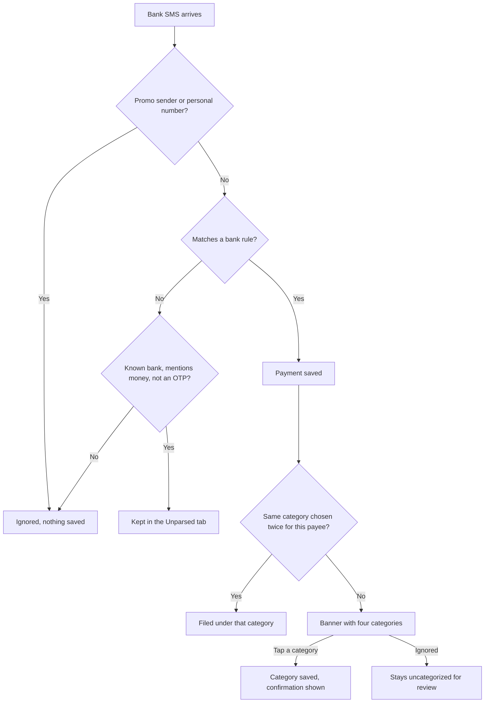

# Live Expense

**An Android app that asks what a payment was for at the moment you make it.**


> [!NOTE]
> **This project is paused, and it isn't a finished product.** It works for the four card and bank message formats it was built around, but it has only been tried on one real phone. If you want an expense tracker to actually use, look at [PennyWise](https://github.com/sarim2000/pennywiseai-tracker), which supports far more banks and is what I use now.

## The idea

Most expense trackers ask you to open an app and log each payment, and that discipline tends to last about a week. Apps that read bank SMS remove the logging, but they still can't tell what ₹340 to an unfamiliar UPI ID was for.

You only reliably know that at the moment you pay, so that's when Live Expense asks:

```text
┌──────────────────────────────────────────────────┐
│  ₹   ₹400 · A Sharma                  IDBI ••999 │
│      [ Food ]  [ Grocery ]  [ Travel ]  [ Shop ] │
│          Not an expense   |   Other…             │
└──────────────────────────────────────────────────┘
```

One tap saves the category. There's no Submit button, and ignoring the banner loses nothing.

## Features

- **Payment capture from bank SMS:** the amount, payee and account are read as the message arrives, and duplicates are dropped.
- **One-tap categories:** a banner offers your four most likely categories, plus "Not an expense" and "Other…".
- **Saved first, asked second:** every payment is stored before the banner appears, so an ignored prompt or a crash can't lose it. It stays uncategorized for you to review later.
- **Payee memory:** a repeat payee gets its category suggested first. After the same choice twice, it's filed without asking. Choosing differently restarts the count, so one wrong tap can't misfile a payee forever.
- **Tap confirmation:** a silent `✓ Bills` pop-up shows which choice landed, and tapping it lets you change the category.
- **Monthly totals:** spending by category, with uncategorized payments shown separately and "Not an expense" left out.
- **Cash entry:** add payments that never produce an SMS.
- **Unparsed tab:** messages from a known bank that mention money but can't be read are kept here, so new formats are visible instead of silently lost.

## How it works



### Supported messages

| Source | Message type | Reads |
|---|---|---|
| IDBI Bank account | UPI debit | Amount, payee, account, UPI reference |
| HDFC credit card | UPI payment | Amount, payee (shown as the UPI ID), card, UPI reference |
| HSBC credit card | Card spend | Amount, merchant, card |
| slice credit card | UPI spend | Amount, merchant, card, UPI reference |

Each rule was written from one real message format, and the rules live in [`BankRules.kt`](app/src/main/java/app/liveexpense/capture/BankRules.kt) as data. Credits, refunds, failed payments, non-UPI card spends and HDFC account debits have no rule yet, so from these banks they land in Unparsed and never count as spending. Bank offers that mention an amount can land there too.

## Privacy

Everything stays on the phone. The guarantees come from what the app is allowed to do, not just from what it chooses to do:

| Guarantee | How it's enforced |
|---|---|
| No network access | `INTERNET` is removed in the manifest with `tools:node="remove"`, so a dependency can't add it back |
| The inbox stays unread | Only `RECEIVE_SMS` is requested, so the app sees new messages only. `READ_SMS` is removed the same way |
| No cloud backup | Auto Backup and device transfer are turned off |
| No tracking | No analytics, crash reporting or network libraries are included |
| Little SMS text kept | Only parsed fields are stored. Raw text is kept only for Unparsed messages, and OTPs and personal messages are never stored |

You can check the permissions yourself on a release build. You should see `RECEIVE_SMS`, `POST_NOTIFICATIONS` and an internal AndroidX permission, and nothing else:

```sh
./gradlew :app:assembleRelease
$ANDROID_HOME/build-tools/<version>/aapt dump permissions app/build/outputs/apk/release/app-release-unsigned.apk
```

The database isn't encrypted. It relies on Android's app sandbox, and encrypted export was planned but never built.

## Known limitations

- **Another app's pop-up can cover the banner.** On my Galaxy S23, Samsung's Brief pop-up style shows Google Messages in a separate window above normal banners, so the SMS itself hid the prompt for about 5 seconds. Switching to the Detailed style should fix this, but I haven't tested it.
- **The banner is brief.** It stays up for about 5 seconds, then moves to the notification shade for up to 3 hours. A new payment replaces the open prompt, and the older payment stays saved as uncategorized.
- **Coverage is narrow.** Only the formats above are read, and Paytm's own messages and wallet spends aren't captured.
- **It depends on banks sending SMS.** HDFC announced in 2024 that it would stop SMS alerts for UPI payments up to ₹100, so small payments may be missed. I haven't measured this gap.
- **No history import.** Without `READ_SMS`, tracking starts from the day you install it.
- **No backup, and no way to edit or delete a payment.** You can change a category, but not an amount. Losing the phone or uninstalling the app loses the data.
- **Transfers count as spending until you say otherwise.** Own-account transfers and card bill payments rely on you tapping "Not an expense".
- **Long payee names get cut off** in the banner.
- **No published build.** There's no signed APK or Play Store listing, so you have to build it yourself.

## Testing

**Checked:**

- 38 JVM unit tests cover parsing, payee memory and totals. Fixtures keep the real message formats with made-up values.
- On an Android 16 emulator: all four formats, including IDBI's two-part SMS, every banner action, payee memory, filtering of duplicates, promos, OTPs and personal numbers, cash entry, and capture after a background kill and a reboot.
- On a Galaxy S23 (Android 16, One UI 8.5): banner layout, category taps, the confirmation pop-up, and a real bank SMS going all the way through to a saved category.

**Not checked:**

- Parsing accuracy across a real inbox. The rules have only seen one sample per format.
- Whether the banner shows over UPI apps.
- Whether capture survives days of inactivity on Samsung, which can put unused apps to sleep.
- The 3-hour prompt expiry.
- Any phone other than that one S23.

## Build and run

You need [Android Studio](https://developer.android.com/studio), which includes the Android SDK and a JDK. Opening the project there and pressing Run is the simplest route. From a terminal on macOS:

```sh
git clone https://github.com/jjinendra3/live-expense-tracker-android.git
cd live-expense-tracker-android

export JAVA_HOME="/Applications/Android Studio.app/Contents/jbr/Contents/Home"
export ANDROID_HOME="$HOME/Library/Android/sdk"

./gradlew :app:testDebugUnitTest
./gradlew :app:assembleDebug
adb install -r app/build/outputs/apk/debug/app-debug.apk
```

Then open the app and tap **Grant access**. Android will describe this as "send and view SMS", although the app can only receive.

### Trying it without making a payment

You can't send a real phone a test SMS from adb, so debug builds include a receiver that runs made-up text through the real parser, database and banner. Only adb can trigger it, and it isn't in release builds. Change the payee and UPI number on each run, since a repeated UPI number counts as a duplicate:

```sh
adb shell am broadcast -n app.liveexpense/.debug.FakeSmsReceiver --es sender VM-IDBIBK-S --es body "'IDBI Bank Acct XX999 debited for Rs 55.00 on 07-Nov-26; Bal Rs 1234.32 Test Payee credited. UPI:111122220001.'"

# Removes only payments whose UPI number starts with 11112222
adb shell am broadcast -n app.liveexpense/.debug.FakeSmsReceiver --ez clear true
```

## Project layout

```text
app/src/main/java/app/liveexpense/
├── capture/   SMS receiver, parser and per-bank rules
├── data/      Room database, payment recording and monthly totals
├── prompt/    Banner, tap handling and payee memory rules
└── ui/        Compose screens
app/src/debug/ adb trigger for made-up payments
app/src/test/  Unit tests
```

It's about 1,100 lines of Kotlin using Jetpack Compose, Material 3 and Room, in a single module with no dependency injection framework. Logic stays in plain functions so it can be tested on the JVM.

## Design decisions

| Decision | Why |
|---|---|
| Regex rules, not an AI model | They're exact and fast, and a miss lands visibly in Unparsed. A model could record a wrong amount without anyone noticing. On-device models were considered but never tried |
| Bank SMS, not notifications | SMS carries the amount, payee and reference, and reading notifications would mean access to every app's notifications |
| A notification banner, not a full-screen prompt | Paying at a counter shouldn't be interrupted. Overlays were also ruled out for now, because Android 12+ lets apps hide them on their own screens |
| One open prompt at a time | With three open, Android bundled them and marked new ones silent, which stopped the banners |
| No suggestion for a new payee | A preselected guess trains you to accept wrong answers |

## How this was built

I built this in about a day to solve my own problem. [Claude Code](https://claude.com/claude-code) wrote the code, while I set the direction, made the product decisions and tested it on my phone.

I paused it once I saw that PennyWise already does the hard parts better. The one thing I didn't find mentioned in its README is the prompt at payment time, which is the idea here that's most worth keeping.

## License

Released under the [MIT License](LICENSE).
